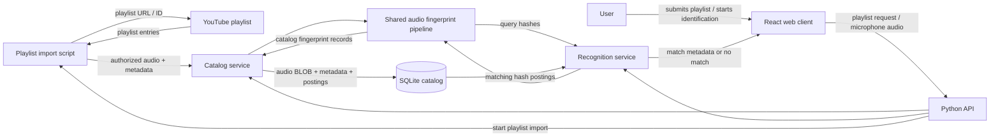

# Magikazaam Architecture

## Status

This describes the intended MVP architecture from [the client brief](client-brief.md). The repository is currently a Python starter scaffold; the React client, API, playlist importer, audio pipeline, and SQLite catalog are not implemented yet. This is a target design, not a description of running services.

## Design goals

- Identify a short microphone recording against the app's prepared playlist catalog.
- Use one deterministic fingerprint pipeline for both catalog indexing and recognition.
- Return **No match found** when the fingerprint evidence is weak or ambiguous.
- Keep microphone recordings ephemeral and keep the MVP small enough to run as one application.

## System shape

The browser handles playlist submission, user interaction, and microphone permission. The Python API owns audio decoding, fingerprint generation, catalog writes, and matching. A Python import script reads a selected YouTube playlist and passes its available metadata and authorized audio to the catalog service. SQLite stores track metadata, catalog audio as BLOBs, and fingerprint postings. The MVP needs no separate recognition service, message queue, or ML model.

## Components

### React web client

- Accepts a YouTube playlist URL or ID and shows import progress and per-track results.
- Displays the imported catalog and its available track metadata.
- Requests microphone permission only after the user starts identification.
- Records a short clip (about 10 seconds), sends it for recognition, and displays a match or no-match result.
- Discards the local recording after the request completes or fails.

The client does not implement a second fingerprinting pipeline; keeping signal processing on the backend prevents indexing and query behavior from drifting apart.

### Python API and application services

The API exposes three MVP operations: import a selected playlist, list indexed catalog tracks, and identify a microphone sample. Exact route names and the Python web framework are implementation choices and are not fixed by the brief.

- **Playlist import script:** reads playlist entries and available metadata, obtains audio only through an authorized method, and submits each track to the catalog service. It returns per-track success or failure when the import completes.
- **Catalog service:** validates audio and metadata, generates fingerprints, and writes audio, track metadata, and postings to SQLite.
- **Recognition service:** validates the sample, generates query hashes, retrieves matching postings, scores time alignment, applies the no-match threshold, and returns track metadata when supported.
- **Shared fingerprint pipeline:** canonicalizes audio, creates its spectrogram, selects peaks, and creates landmark hashes. Both services call the same implementation and configuration.

### Audio pipeline

Apply identical processing to catalog audio and query samples:

1. Decode supported audio formats, downmix to mono, and resample to the configured sample rate.
2. Compute an overlapping-window STFT and magnitude spectrogram.
3. Select strong local peaks distributed over time and frequency.
4. Pair each anchor peak with peaks in its bounded forward target zone.
5. Quantize the anchor frequency, target frequency, and time delta into a stable hash; retain the anchor time with each hash.

The client brief's Rochester-paper settings are the initial evaluation baseline: 8,192 Hz, a 1,024-sample Hamming window, a 32-sample hop, six logarithmic frequency bands, local maximum filtering, and a 50-frame target zone. Keep these values in one backend configuration used by indexing and recognition. Store the fingerprint configuration/version with catalog metadata; a configuration change makes existing fingerprints stale and requires re-indexing.

### SQLite and catalog audio

Store catalog audio as SQLite BLOBs with its metadata and compact fingerprint postings. This follows the project's explicit storage requirement and keeps a bounded MVP catalog in one database; monitor database size and backup time as the playlist grows.

| Table | Purpose | Core fields |
|---|---|---|
| `tracks` | One row per indexed catalog track | `id`, `title`, `artist_or_channel`, `source_url`, `audio_blob` |
| `fingerprints` | Inverted hash postings for lookup | `hash`, `track_id`, `anchor_frame` |
| `catalog_meta` | Fingerprint compatibility state | algorithm/config version and parameters |

Add a non-unique index on `fingerprints.hash` so a hash lookup returns every matching `(track_id, anchor_frame)` posting. The same hash can legitimately occur more than once in one or more tracks. `fingerprints.track_id` references `tracks.id`; deleting a track's catalog entry must remove its postings and associated source audio.

Write one track, its audio BLOB, metadata, and all fingerprint rows in a transaction. If validation, decoding, fingerprint generation, or the database write fails, roll back the track and postings. The catalog audio is retained for re-indexing when the fingerprint configuration changes; it is distinct from microphone query audio.

## Main data flows

### Add a catalog track

1. The client submits a YouTube playlist URL or ID to the Python API.
2. The API runs the playlist import script, which reads playlist entries and available metadata and obtains audio through an authorized method.
3. For each track, the catalog service validates the audio, runs the shared pipeline, and creates landmark hash postings.
4. A SQLite transaction stores the audio BLOB, metadata, and postings. When the import completes, the client receives a result for each track.

The importer must not assume playlist metadata access also grants audio-download rights. The audio acquisition method must be authorized for the catalog tracks being stored.

### Identify a song

1. The user starts identification; the browser requests permission and records about 10 seconds.
2. The client sends the sample to the API. The API validates its format and duration, then processes it in memory or temporary storage.
3. The shared pipeline creates query hashes. The recognition service looks up each hash through the SQLite index.
4. For each posting, calculate `track_time − query_time` and group votes by track and nearby offset.
5. Rank candidates by aligned support relative to usable query hashes. Return metadata only when the best candidate passes the validated threshold; otherwise return **No match found**.
6. Discard the query audio and temporary query fingerprints after processing, including on failure.

## API behavior

The API needs three logical operations:

- **Import playlist:** accepts a YouTube playlist URL or ID, runs the importer, and returns per-track success or a useful validation/processing error.
- **List catalog:** returns indexed track metadata for the frontend catalog view.
- **Identify:** accepts one short audio sample; returns either a matched track's available metadata or a no-match result.

No listening history or query audio is persisted. A no-match response is a normal recognition outcome, distinct from an API or processing error.

## Reliability and privacy

- Validate audio format, duration, and upload size at the API boundary before decoding.
- Treat microphone permission denial, an empty/too-short recording, unsupported audio, and processing failure as clear errors; do not present them as a song match.
- Keep catalog indexing atomic per track so failures cannot create incomplete fingerprints.
- Request microphone access only in response to the user's action. Do not retain microphone clips or query fingerprints after a request.
- Do not log raw audio or metadata beyond what is needed to operate the catalog. Measure recognition quality with a separate labeled evaluation set; measure runtime processing time without retaining audio.
- Catalog source audio must be supplied or obtained through authorized means.

## Evaluation and tuning

Use a labeled evaluation set containing clips from different points in indexed tracks and negative clips from tracks outside the catalog. Measure recognition accuracy, false-positive rate, and processing time. Tune peak selection, target-zone and hash quantization settings, offset tolerance, and the no-match threshold against that set. The brief specifies no numeric accuracy or latency target, so do not treat a result as accepted based on an arbitrary hard-coded score.

## Deployment boundary

For the MVP, the React client, Python API, playlist import script, and SQLite database can run as one application deployment on one machine. Keep the database on persistent storage and back it up; it contains both metadata and catalog audio. A distributed deployment, multi-user access model, and external storage service are not part of the brief and should be decided only if the product needs them.
